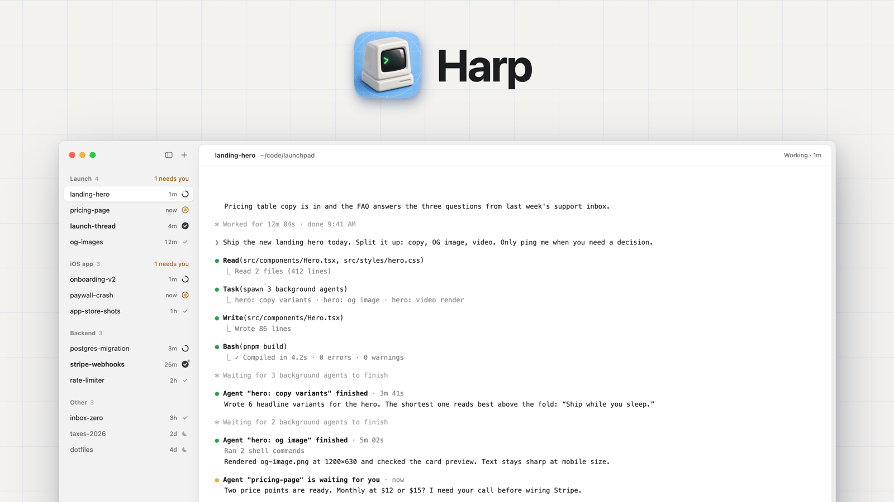
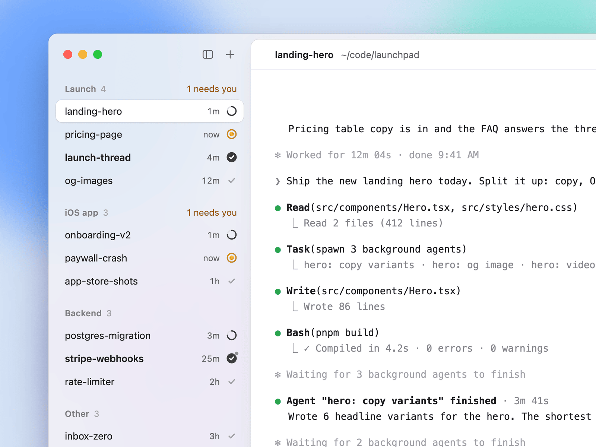
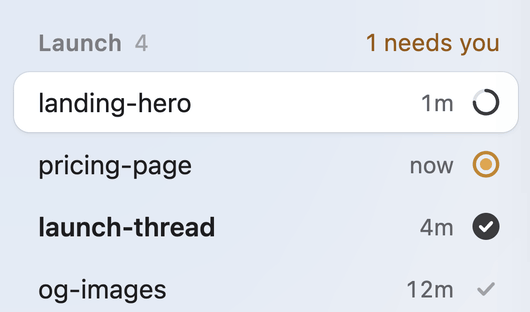
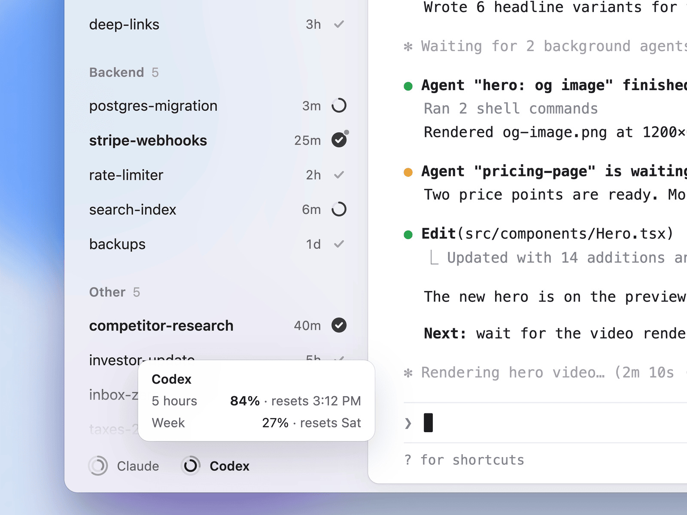

<p align="center">
  <picture>
    <source media="(prefers-color-scheme: dark)" srcset="images/hero-dark.png">
    
  </picture>
</p>

<p align="center">
  Run many Claude Code and Codex agents side by side, in one calm sidebar that tells you which one needs you.
</p>

<p align="center">
  <a href="LICENSE-AGPL"></a>
  
</p>

Harp is an unofficial fork of the open-source [Warp](https://github.com/warpdotdev/warp) terminal.
It replaces the tab bar with a sidebar built for long-running coding agents and keeps the rest of
Warp as it is.

## What it adds

<table>
  <tr>
    <td width="50%" valign="top">
      <picture>
        <source media="(prefers-color-scheme: dark)" srcset="images/sidebar-dark.png">
        
      </picture>
      <picture>
        <source media="(prefers-color-scheme: dark)" srcset="images/working-rings-dark.gif">
        
      </picture>
    </td>
    <td width="50%" valign="top">
      <h3>Agent states at a glance</h3>
      <p>Each row shows whether its Claude Code or Codex session is working, waiting for you or
      done, with an unread mark until you look. A dot means background work is still running;
      a moon marks a tab you set aside. Cmd+R renames a tab.</p>
      <h3>Groups that stay put</h3>
      <p>Put tabs into named groups. With the tmux integration on, the group and the order are
      stored on the tmux sessions, so they survive a restart and other tmux clients see the
      same layout.</p>
    </td>
  </tr>
  <tr>
    <td width="50%" valign="top">
      <picture>
        <source media="(prefers-color-scheme: dark)" srcset="images/limit-rings-dark.png">
        
      </picture>
    </td>
    <td width="50%" valign="top">
      <h3>Limit rings</h3>
      <p>Two rings per provider in the footer: the 5 hour window and the weekly limit. Harp reads
      the numbers from a local JSON file that a tool of your choice keeps current
      (<a href="docs/limit-rings.md">format</a>); it never fetches them itself.</p>
      <h3>Phone-friendly tmux</h3>
      <p>Tabs attached to tmux follow their session: name, group, read and inactive flags.
      A session started elsewhere, for example from your phone over ssh, can ask for a tab
      with <code>tmux set-option @warp_adopt 1</code>.</p>
    </td>
  </tr>
</table>

Everything else is upstream Warp, including its AI and cloud features (agents, Warp Drive, session
sharing, login). They talk to Warp's servers exactly as upstream does; Harp adds no servers of its
own. Logging in through Harp is untested.

## Install

**Download:** grab the latest `Harp-<version>.dmg` from [Releases](../../releases/latest) and drag
Harp into Applications. Harp has its own bundle id (`com.dominikmartn.Harp`), URL scheme (`harp://`)
and settings folder (`~/.harp`), so it runs next to Warp without sharing anything.

**Build from source** (macOS, Rust toolchain from `rust-toolchain.toml`):

```sh
./script/bootstrap   # one-time: toolchain and build dependencies
./script/run         # builds target/debug/bundle/osx/Harp.app and launches it
```

`script/macos/run` signs with the first "Apple Development" identity in your keychain and falls
back to an ad-hoc signature. A signed, notarizable release DMG comes from `script/release_macos`
(see `--help`).

## Settings

The extras are off by default. Turn them on in `~/.harp/settings.toml`; the app reloads the file
when it changes.

```toml
[integrations.limit_rings]
enabled = true
file = "~/.cache/limit-rings.json"

[integrations.tmux]
enabled = true
```

| Setting | Default | Effect |
|---|---|---|
| `integrations.limit_rings.enabled` | `false` | Shows the limit rings in the sidebar footer. |
| `integrations.limit_rings.file` | `""` | JSON file the rings read; `~` is your home folder. |
| `integrations.tmux.enabled` | `false` | Tmux sync (names, groups, order, flags, adopting sessions) and agent detection inside tmux. Polls every 10 s. |
| `integrations.tmux.session_script` | `""` | Optional script that renames and regroups instead of the built-in tmux commands: `<script> rename <shell_pid> <group> <title>`, `<script> group <session_id> <old_group> <new_group>`. |
| `appearance.vertical_tabs.full_tab_menu` | `true` | `false` shrinks the tab and group menus to the essentials. Also in Settings > Appearance > Tabs. |
| `agents.third_party.should_render_cli_agent_toolbar` | `false` | `true` brings back upstream's toolbar under CLI agent sessions. With it off, update the Warp plugin for Claude Code through Claude Code's plugin marketplace. |

A Claude Code hook that reports background tasks to the sidebar lives in
[integrations/claude-code](integrations/claude-code/README.md).

<details>
<summary>Details for contributors</summary>

**Removed on purpose:** the tab bar's search field, view options and tab-config buttons in the
sidebar layout (new tabs come from Cmd+T, a double-click or the right-click menu on empty sidebar
space), the sidebar divider option and the title-strip panel toggles.

**Development switches** (environment, at launch): `WARPOSS_STATUS_TRACE=1` logs every change of a
row's shown status to `~/Library/Logs/harp.log` as a `[status-check]` line, for regression checks
against an agent's transcript. `WARPOSS_SKIP_LOGIN=1` starts with a test user and fails every
authenticated request, for automated runs without a login. `WARP_DATA_PROFILE=<name>` (debug
builds) keeps settings and data in `~/.harp-<name>`.

**Identity:** the name comes from `app_display_name!()` in `app/src/lib.rs`. Bundle id, URL scheme
and settings folder are set in `app/Cargo.toml`, `app/src/bin/oss.rs`,
`crates/warp_core/src/channel/state.rs`, `crates/warp_core/src/paths.rs`, `script/macos/bundle`,
`script/macos/run`, `crates/warpui/src/browser.rs`, `app/channels/oss/com.dominikmartn.Harp.desktop`
and `flake.nix`. Internal names stay Warp's: the `warp-oss` binary, the crates, the `WARPOSS_*`
switches and the `@warp_*` tmux options other tmux clients read.

Run `./script/presubmit` (format, clippy, tests) before sending changes.

</details>

## Based on Warp

Harp is an unofficial fork of [warpdotdev/warp](https://github.com/warpdotdev/warp) and is not
made, endorsed or supported by Warp (Denver Technologies, Inc.) or affiliated with them. "Warp" is
their name. Please report issues with Harp here, not to Warp.

## Credits

- [Warp](https://github.com/warpdotdev/warp), the terminal Harp is built on, and the open-source
  projects it depends on ([list](https://docs.warp.dev/help/licenses)).
- Sidebar icons from the [Hugeicons](https://hugeicons.com) free set (MIT) and
  [Phosphor](https://phosphoricons.com) (MIT); the licenses are in
  `app/assets/bundled/svg/hugeicons/` and `app/assets/bundled/svg/phosphor/`.

## License

Like upstream, the code is under the [GNU AGPL v3](LICENSE-AGPL), except the `warpui` and
`warpui_core` crates, which are [MIT](LICENSE-MIT). If you run a modified version for others over a
network, the AGPL asks you to offer them its source.
